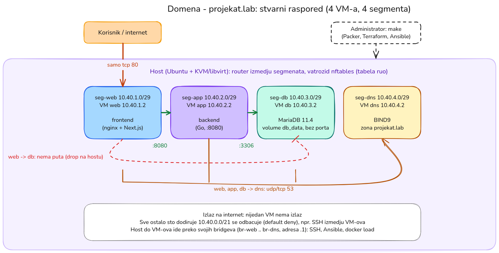

# Troslojna aplikacija kao kod

Projekat iz predmeta Računarstvo u oblaku (Univerzitet u Zenici, 2026/27).
Ovo je infrastruktura za troslojnu web aplikaciju (frontend, backend, baza) i cijela je opisana kodom:
Packer pravi baznu sliku, Terraform pravi mreže, VM-ove i DNS zapise, cloud-init radi početnu
konfiguraciju VM-ova, Ansible konfiguriše servere i isporučuje kontejnere, a vatrozid hosta mrežno
odvaja slojeve. Cijeli sistem se podiže jednom naredbom (`make all`) i uklanja jednom naredbom (`make destroy`).

Obrazloženja svih dizajnerskih odluka (ADR-ovi) su u [docs/ADR.md](docs/ADR.md) (PDF: [docs/ADR.pdf](docs/ADR.pdf)).

## Sadržaj

1. [Aplikacija](#1-aplikacija)
2. [Arhitektura](#2-arhitektura)
3. [Plan adresiranja i izolacija slojeva](#3-plan-adresiranja-i-izolacija-slojeva)
4. [DNS](#4-dns)
5. [Tajne](#5-tajne)
6. [Trajnost baze](#6-trajnost-baze)
7. [Struktura repozitorija](#7-struktura-repozitorija)
8. [Pokretanje od praznog računara](#8-pokretanje-od-praznog-računara)
9. [Šta radi `make all`, korak po korak](#9-šta-radi-make-all-korak-po-korak)
10. [Dokazi: testovi, idempotentnost, drift](#10-dokazi-testovi-idempotentnost-drift)

---

## 1. Aplikacija

**Invoice tracker**: evidencija faktura (broj, klijent, iznos, status `draft/sent/paid`, rok plaćanja).
Fakture se mogu pregledati i dodavati.

| Sloj     | Tehnologija                                                | Kontejner                 |
| -------- | ---------------------------------------------------------- | ------------------------- |
| frontend | Next.js 16 (React), statički export, servira ga nginx 1.27 | `ruo/frontend:1.0`        |
| backend  | Go 1.24, `net/http`, REST API (`/invoices`, `/health`)     | `ruo/backend:1.0`         |
| baza     | MariaDB 11.4, tabela `invoices` (`app/backend/db/schema.sql`) | `mariadb:11.4` + volume |

Tok zahtjeva je samo **frontend → backend → baza**: preglednik razgovara samo s nginx-om na web VM-u.
nginx prosljeđuje `/api/*` na `http://app.projekat.lab:8080`, a backend se spaja na `db.projekat.lab:3306`.
Preglednik nikad ne vidi backend ni bazu.

**Zašto baš fakture.** Aplikacija je namjerno izabrana tako da čuva *osjetljive* podatke: ko je kome i
koliko dužan. To su finansijski i poslovni podaci klijenata, i curenje baze je ovdje stvarna šteta.
Zbog toga je projekat urađen tako da napadač koji preuzme izloženi dio sistema (frontend) i dalje
nema put do baze. Odatle dolaze glavne odluke:

- svaki sloj ima **svoj VM i svoju mrežu**, a ne samo svoj kontejner na zajedničkom VM-u;
- pravila prometa se provode **na hostu**, van VM-ova, pa ih ni root na kompromitovanom VM-u ne može promijeniti;
- **nijedan VM nema izlaz na internet** (podaci se ne mogu lako iznijeti, a ni alati unijeti);
- lozinke se **generišu** pri prvom pokretanju, ne postoje u Gitu, a svaki sloj dobija samo svoje.

## 2. Arhitektura

Četiri VM-a (web, app, db, dns). Svaki je sam u svojoj libvirt mreži u `route` modu. Host je
gateway (`.1`) svih mreža, usmjerava promet između njih i filtrira ga vatrozidom (nftables).



Gateway svakog segmenta je adresa hosta `.1` na bridgeu `br-web`, `br-app`, `br-db` ili `br-dns`.
Administrator sve radi s hosta kroz `make`. Host do VM-ova dolazi direktno preko svojih bridgeva
(SSH za Ansible, testove i `docker load`), a VM-ovi međusobno SSH-om ne mogu.

**Zašto više VM-ova, a ne jedan VM s Docker mrežama.** Na jednom VM-u svi kontejneri dijele isti
kernel i isti Docker daemon, a izolaciju provodi taj isti VM. Ko dobije root na njemu, dobija i
bazu i njen volume. Ovdje je svaki sloj zaseban VM, sam u svojoj /29 mreži, pa jedini put prema
drugom sloju vodi kroz host, a host propušta samo propisane portove. Cijena je više RAM-a
(4 × 1 GiB), sudo na hostu i nešto složeniji kod (DO-2 u [ADR-ovima](docs/ADR.md)).

## 3. Plan adresiranja i izolacija slojeva

| Segment | Libvirt mreža / bridge | Podmreža     | Gateway (host) | VM      | MAC                 | Uloga                    |
| ------- | ---------------------- | ------------ | -------------- | ------- | ------------------- | ------------------------ |
| web     | `seg-web` / `br-web`   | 10.40.1.0/29 | 10.40.1.1      | 10.40.1.2 | 52:54:00:40:01:02 | frontend, jedini izložen |
| app     | `seg-app` / `br-app`   | 10.40.2.0/29 | 10.40.2.1      | 10.40.2.2 | 52:54:00:40:02:02 | backend                  |
| db      | `seg-db` / `br-db`     | 10.40.3.0/29 | 10.40.3.1      | 10.40.3.2 | 52:54:00:40:03:02 | baza                     |
| dns     | `seg-dns` / `br-dns`   | 10.40.4.0/29 | 10.40.4.1      | 10.40.4.2 | 52:54:00:40:04:02 | BIND, zona projekta      |

- Cijeli projekat je u `10.40.0.0/21` (treći oktet = segment). Taj opseg se ne sudara s libvirt
  `default` mrežom (192.168.122.0/24), Dockerom (172.17.0.0/16) ni kućnim mrežama (192.168.x.x).
  Vatrozid dira samo promet koji dodiruje taj opseg.
- Adrese su **statičke**: DHCP je isključen, a cloud-init (netplan) postavlja adresu po MAC adresi.
  MAC u sebi nosi segment (`…:40:0N:02`).
- Svi podaci o segmentima su na **jednom mjestu**: varijabla `segments` u `terraform/vm/variables.tf`.
  Iz nje nastaju mreže, VM-ovi, cloud-init, inventar i varijable za Ansible.

### Kako je izvedena izolacija

1. **Mreža**: svaki VM je sam u svojoj L2 mreži, pa nema "susjeda" do kojeg bi došao mimo hosta.
   Libvirt u `route` modu ne radi NAT. Daje bridge s adresom `.1` i na njoj pokreće dnsmasq (DNS).
2. **Vatrozid na hostu**: rola `firewall` pravi tabelu `ip ruo` (`/etc/nftables.d/ruo.nft`).
   Lanac `forward` propušta samo ono što je navedeno, a sav ostali promet koji dodiruje
   `10.40.0.0/21` odbacuje (default deny, uz log `ruo-drop:`). Lanac `input` odbacuje svaku novu
   vezu s VM-a prema samom hostu (npr. dnsmasq na `.1`, koji bi VM-ovima dao DNS izlaz na internet),
   a propušta samo odgovore na veze koje otvara host. Tabele libvirta i Dockera se ne diraju.
   Systemd unit `ruo-firewall.service` ponovo učitava pravila poslije restarta hosta.
3. **Politika je zapisana kao podaci** u `ansible/group_vars/rtr/vars.yml`, a šablon
   `ruo.nft.j2` je prevodi u pravila. Promjena politike ide samo tu:

| Od → do          | Dozvoljeno             | Zašto                                    |
| ---------------- | ---------------------- | ---------------------------------------- |
| internet → web   | tcp 80                 | jedini ulaz izvana                       |
| web → app        | tcp 8080               | nginx → backend API                      |
| app → db         | tcp 3306               | backend → MariaDB                        |
| web, app, db → dns | udp/tcp 53           | razrješavanje imena zone                 |
| **sve ostalo**   | **drop**               | npr. web → db, SSH između VM-ova, VM → internet |

4. **Baza nema objavljen port**: kontejner baze radi s `network_mode: host` i bez `ports:`.
   MariaDB sluša na adresi db VM-a, a do porta 3306 smije doći samo app segment (pravilo na hostu).

Napomena: "izvana" znači promet koji na host stiže kroz uplink (sučelje sa zadanom rutom). Klijent iz
lokalne mreže mora imati rutu za `10.40.1.0/29` preko hosta. Sam host aplikaciju otvara kao
`http://web.projekat.lab/`.

## 4. DNS

- Zona **`projekat.lab`**, TTL **300 s**, jedan primarni BIND9 server na dns VM-u (`ns1.projekat.lab` = 10.40.4.2).
- Zonu i početni zonski fajl (SOA, NS, `ns1`) pravi Ansible (rola `dns`). **Zapise servisa
  `web`, `app`, `db` i `dns` dodaje Terraform** (`terraform/dns`, provider `hashicorp/dns`, dinamičko
  ažuriranje po RFC 2136, potpisano TSIG ključem `ruo-tf`).
- TSIG ključ smije mijenjati **samo ovu zonu**: `update-policy { grant ruo-tf zonesub ANY; };`.
- Server je samo autoritativan za `projekat.lab` (`recursion no`), a upiti su dozvoljeni samo iz
  `10.40.0.0/21` i s localhosta. Vanjska imena dobijaju `REFUSED`, jer VM-ovima ne trebaju.
- VM-ovi dobijaju dns VM kao resolver iz cloud-init-a. Komponente se adresiraju **samo imenima**:
  `db.projekat.lab` (DSN backenda) i `app.projekat.lab` (`BACKEND_URL` za nginx). U `app/` i u
  rolama nema adresa drugih komponenti, samo loopback `127.0.0.1` (healthcheck kontejnera i
  `listen-on` BIND-a).
- Host razrješava zonu preko split DNS-a (rola `host_dns`, unit `ruo-dns.service`):
  `resolvectl` šalje na dns VM samo upite za `~projekat.lab`, a sve ostalo ide kao i prije.
- TTL ima jedan izvor: `dns_ttl` u `terraform/vm`. Odatle ga čitaju i rola `dns` (zonski fajl) i
  `terraform/dns` (zapisi), pa se ne mogu razići.

## 5. Tajne

U Gitu nema nijedne tajne projekta ni primjera s pravom lozinkom. Jedini izuzetak je build lozinka
`packer` za privremeni Packer VM: zaključava se prije snimanja slike, a VM-ovi ne primaju prijavu
lozinkom (DO-9 u [ADR-ovima](docs/ADR.md)). Tajne se **generišu pri prvom pokretanju**
(Ansible `lookup('password')`) i čuvaju samo na hostu, u `ansible/.secrets/` (u `.gitignore`):

| Fajl                 | Šta je                         | Ko ga koristi                                   |
| -------------------- | ------------------------------ | ----------------------------------------------- |
| `tsig_ruo-tf`        | TSIG tajna (hmac-sha256)       | BIND (`/etc/bind/ruo-tf.key`, 0640 root:bind) i Terraform (`TF_VAR_tsig_secret`, `sensitive`) |
| `db_password`        | lozinka korisnika `invoices`   | baza i backend (`.env`)                         |
| `db_root_password`   | root lozinka MariaDB           | samo baza (`.env`)                              |

- Ista naredba drugi put čita postojeći fajl, pa se lozinke ne mijenjaju između pokretanja.
- Na VM-u je `.env` u `/opt/ruo-app/.env` (vlasnik root, 0600) i svaki sloj dobija **samo svoje**
  varijable: web samo `BACKEND_URL`, app `DSN` i `FRONTEND_ORIGIN`, db samo `MARIADB_*`. Taskovi s tajnama imaju `no_log: true`.
- SSH: VM-ovi primaju samo javni ključ hosta (`~/.ssh/id_ed25519.pub`). Prijava lozinkom je isključena.
- `.gitignore` isključuje `*.tfstate`, `.terraform/`, `.env`, `ansible/.secrets/`, generisani inventar i `*.qcow2`.

## 6. Trajnost baze

Podaci MariaDB-a su u imenovanom Docker volumenu `db_data` (`/var/lib/mysql`) na db VM-u. Kontejner
baze se može obrisati i ponovo napraviti (`docker compose up --force-recreate`) bez gubitka podataka.
To provjerava `tests/db.sh`: upiše fakturu kroz aplikaciju, ponovo kreira kontejner (provjeri da je
ID novi), pa provjeri da je faktura i dalje tu. Šema (`schema.sql`) se izvršava samo pri prvom
startu prazne baze i idempotentna je (`CREATE TABLE IF NOT EXISTS`, seed samo ako ne postoji).
`make destroy` namjerno briše i podatke, jer briše VM-ove.

## 7. Struktura repozitorija

```
projekat/
├── app/
│   ├── frontend/            # Next.js + nginx.conf + multi-stage Dockerfile
│   ├── backend/             # Go API + schema.sql + multi-stage Dockerfile
│   └── compose.yaml         # tri servisa, profil po sloju (web | app | db)
├── packer/                  # bazna slika VM-ova: Ubuntu noble + docker + bind9
├── terraform/
│   ├── vm/                  # mreže, diskovi, VM-ovi; generiše inventar za Ansible
│   │   └── cloud-init/      # user-data i network-config šabloni
│   └── dns/                 # A zapisi servisa (RFC 2136 + TSIG)
├── ansible/
│   ├── site.yml             # make config: vatrozid, BIND, split DNS hosta
│   ├── deploy.yml           # make deploy: slike i kontejneri
│   ├── group_vars/          # politika vatrozida, slike, profil po sloju
│   └── roles/               # firewall, dns, host_dns, app
├── tests/                   # izolacija, DNS, SSH, aplikacija, trajnost baze
├── docs/                    # ADR.md + ADR.pdf (DO i ADR-ovi), dijagram (png + excalidraw)
├── setup.sh                 # instalacija i podešavanje alata na hostu (make setup)
├── ssh_config               # ručni SSH na VM-ove
└── Makefile
```

Odstupanja od preporučene strukture:

- **`cloud-init/` je u `terraform/vm/cloud-init/`** jer su to Terraform šabloni (`templatefile`) i
  koristi ih samo taj modul.
- **Dodat je `packer/`** jer bazna slika nastaje kodom (DO-4).
- **Dodat je `docs/`**: dizajnerske odluke i ADR-ovi (`ADR.md`, iz njega generisan `ADR.pdf`) i
  dijagram stvarnog rasporeda (`dijagram.png`, izvor `arhitektura.excalidraw`).
- **Nema role `docker`**: Docker je već u Packer slici, pa ga Ansible ne instalira (VM-ovi app i db
  nemaju internet).

## 8. Pokretanje od praznog računara

### Preduslovi

Host: **Ubuntu 24.04** (x86_64) s uključenom virtualizacijom (KVM), oko 5 GiB slobodnog RAM-a,
15 GiB diska, internet (za Packer sliku i Docker slike) i korisnik sa `sudo` pravom. Host mora
koristiti `systemd-resolved` (podrazumijevano na Ubuntuu), zbog split DNS-a.

Sve alate (i `make`) instalira i podešava `./setup.sh` (isto što i `make setup`, idempotentna).
Nakon prvog pokretanja potrebno je odjaviti se i ponovo prijaviti (nove grupe `libvirt`, `kvm`, `docker`).

Podržan je i WSL2 Ubuntu 24.04 na Windowsu 11 (nested virtualizacija, `/dev/kvm`). Skripta se
pokreće u WSL terminalu i sama uključuje systemd i `systemd-resolved` (`/etc/wsl.conf`). Kad to
zatraži, u PowerShellu se pokrene `wsl --shutdown` i zatim ponovo `./setup.sh`.

Korišteno i provjereno s: Terraform 1.17.2, Packer 1.16.2, ansible-core 2.16.3 (community.docker
3.7.0, ansible.posix 1.5.4), Docker 29.9.3, libvirt 10.0.0.

### Naredbe

```bash
git clone https://github.com/kadusic1/ruo_project.git projekat && cd projekat
./setup.sh      # instalacija i podešavanje alata na hostu (traži sudo; isto što i make setup)
make check      # provjera alata, libvirta i SSH ključa
make all        # infra → config → dns → deploy → test (prvi put ~10 min zbog Packer slike)
```

`make config` traži sudo lozinku (`-K`) jer vatrozid i split DNS idu na host. Ako sudo ne traži
lozinku: `make ANSIBLE_ARGS= config`.

| Cilj               | Šta radi                                                                                 |
| ------------------ | ---------------------------------------------------------------------------------------- |
| `make help`        | popis ciljeva                                                                            |
| `make check`       | provjera alata, libvirta, Dockera i SSH ključa                                           |
| `make image`       | Packer: bazna slika `packer/output/ruo-base.qcow2` (gradi se samo kad se `packer/` promijeni) |
| `make infra`       | Terraform (`terraform/vm`): mreže i VM-ovi, generiše inventar i varijable za Ansible     |
| `make config`      | Ansible (`site.yml`): vatrozid hosta, BIND na dns VM-u, split DNS hosta                  |
| `make dns`         | Terraform (`terraform/dns`): A zapisi `web`, `app`, `db`, `dns` (RFC 2136, TSIG)                |
| `make deploy`      | Ansible (`deploy.yml`): build slika na hostu, prenos na VM-ove, pokretanje kontejnera    |
| `make test`        | testovi izolacije, DNS-a, SSH-a, aplikacije i trajnosti baze                             |
| `make drift`       | `terraform plan -detailed-exitcode` za `terraform/vm` i `terraform/dns`, bez izmjena; izlaz 2 = drift |
| `make all`         | `infra config dns deploy test`, od praznog sistema do aplikacije koja radi               |
| `make destroy`     | briše DNS zapise, VM-ove, mreže, state, tajne, slike aplikacije i vatrozid/DNS na hostu  |
| `make clean-image` | briše Packer sliku (sljedeći `make infra` je gradi ponovo)                               |

Tok odbrane (od nule, pa drugo izvršavanje bez promjena):

```bash
make destroy    # prazan sistem (Packer slika ostaje kao keš; potpuno od nule: make destroy clean-image)
make all        # infra → config → dns → deploy → test
make test       # izolacija, dig, SSH, aplikacija, trajnost baze
make all        # drugi put: Terraform 0 promjena, Ansible changed=0
```

Aplikacija je u pregledniku na hostu: **http://web.projekat.lab/**

### Uklanjanje

`make destroy` uklanja sve što je projekat napravio: DNS zapise, VM-ove, diskove i mreže, Terraform
state, generisane tajne i tar slike, slike aplikacije i build keš Dockera na hostu, tabelu `ip ruo`,
unite `ruo-firewall` i `ruo-dns` i `/etc/sysctl.d/90-ruo.conf`. Ostaju Packer slika i Packer keš
(da sljedeći `make all` ne gradi sliku ponovo) i runtime `net.ipv4.ip_forward=1` (trebaju ga i
libvirt i Docker; poslije restarta vrijedi sistemska vrijednost).

### Ručni SSH na VM-ove (opcionalno)

Fajl `ssh_config` postavlja korisnika `student` za sve VM-ove, pa se ne navodi `-i` ni korisnik:

```bash
ssh -F ssh_config web.projekat.lab     # ili po adresi: ssh -F ssh_config 10.40.3.2
```

VM-ovi pri svakom ponovnom kreiranju dobijaju nove ključeve hosta. Zato `ssh_config` i testovi te
ključeve ne pamte (`StrictHostKeyChecking no`, `UserKnownHostsFile /dev/null`), a `ansible.cfg`
isključuje njihovu provjeru (`host_key_checking = False`).

## 9. Šta radi `make all`, korak po korak

1. **`make image`** (dio `infra`). Packer pokrene datiranu Ubuntu noble cloud sliku
   (`20261017`, provjeren sha256), instalira `docker.io`, `docker-compose-v2` i `bind9`, isključi
   `named` (uključuje ga samo rola `dns`), zaključa privremenu build lozinku i očisti cloud-init.
   Rezultat je jedna slika za sve VM-ove, pa VM-ovima ne treba internet da bi bili konfigurisani.
2. **`make infra`**. Terraform pravi 4 mreže (`route` mode, bez DHCP-a), bazni volumen iz Packer
   slike i za svaki VM copy-on-write disk, cloud-init ISO i domenu (1 vCPU, 1 GiB RAM, 10 GiB disk,
   sve su varijable). Cloud-init postavlja hostname, korisnika `student` (sudo, grupa `docker`,
   samo SSH ključ), `ssh_pwauth: false` i statičku adresu (netplan). Terraform na kraju piše
   `ansible/inventory.ini` i `ansible/group_vars/all/terraform.yml` (podmreže, adrese, zona, TTL).
   Outputi: `ip`, `mreze`, `dns_zone`, `dns_ttl`.
3. **`make config`** (`ansible/site.yml`). Provjeri da postoje generisane varijable, sačeka SSH i
   cloud-init na svim VM-ovima, pa:
   `firewall` na hostu (nftables pravila, `ip_forward`, unit za boot) →
   `dns` na dns VM-u (TSIG ključ, `named.conf.*` uz `named-checkconf`, početna zona samo ako ne postoji) →
   `host_dns` na hostu (split DNS za `projekat.lab`).
4. **`make dns`**. Makefile pročita TSIG tajnu iz `ansible/.secrets/tsig_ruo-tf` i preda je
   Terraformu kroz varijablu okruženja. `terraform/dns` uzima adrese i zonu iz state-a `terraform/vm`
   (`terraform_remote_state`) i pravi A zapise.
5. **`make deploy`** (`ansible/deploy.yml`). Host izgradi `ruo/backend` i `ruo/frontend`
   (multi-stage Dockerfile) i povuče `mariadb:11.4`. Rola `app` se izvrši redom na db, app i web:
   prenese sliku (`docker save` → kopija → `docker load`) samo ako se ID slike na VM-u razlikuje,
   kopira `compose.yaml`, napravi `.env` za taj sloj i pokrene samo njegov compose profil
   (bez builda i pulla na VM-u). Na kraju čeka health: baza → `/health` backenda → `/api/invoices`
   kroz nginx (cijeli lanac).
6. **`make test`**. Pokreće pet testova iz `tests/` (izlaz ispod).

## 10. Dokazi: testovi, idempotentnost, drift

### Izlaz testova (`make test`)

Redovi `-> internet :443` u `tests/isolation.sh` provjeravaju izlaz VM-ova na internet (veza
prema `1.1.1.1:443`): ne smije nijedan VM. Ulaz izvana na web je samo tcp 80.

```
bash tests/isolation.sh
Matrica povezivosti (inventar: .../ansible/inventory.ini)
  (10.40.2.2:8080: servis vec slusa, slusalac se ne pokrece)
  (10.40.3.2:3306: servis vec slusa, slusalac se ne pokrece)
  web   -> app        :8080   dozvoljeno  (ocekivano: dozvoljeno ) ok
  app   -> db         :3306   dozvoljeno  (ocekivano: dozvoljeno ) ok
  web   -> db         :3306   blokirano   (ocekivano: blokirano  ) ok
  web   -> app        :22     blokirano   (ocekivano: blokirano  ) ok
  app   -> db         :22     blokirano   (ocekivano: blokirano  ) ok
  web   -> dns        :53     dozvoljeno  (ocekivano: dozvoljeno ) ok
  app   -> dns        :53     dozvoljeno  (ocekivano: dozvoljeno ) ok
  db    -> dns        :53     dozvoljeno  (ocekivano: dozvoljeno ) ok
  web   -> dns        :22     blokirano   (ocekivano: blokirano  ) ok
  dns   -> db         :3306   blokirano   (ocekivano: blokirano  ) ok
  app   -> internet   :443    blokirano   (ocekivano: blokirano  ) ok
  db    -> internet   :443    blokirano   (ocekivano: blokirano  ) ok
  dns   -> internet   :443    blokirano   (ocekivano: blokirano  ) ok
  web   -> internet   :443    blokirano   (ocekivano: blokirano  ) ok

sve provjere odgovaraju ocekivanjima
bash tests/dns.sh
DNS provjere (zona projekat.lab, server 10.40.4.2)
  dig @10.40.4.2 web.projekat.lab                      ok
  dig @10.40.4.2 app.projekat.lab                      ok
  dig @10.40.4.2 db.projekat.lab                       ok
  dig @10.40.4.2 dns.projekat.lab                      ok
  web: getent hosts db.projekat.lab                    ok
  host: getent hosts web.projekat.lab                  ok
  dig @10.40.4.2 archive.ubuntu.com (REFUSED)          ok
  dig @10.40.4.2 nepostoji.projekat.lab (NXDOMAIN)     ok

sve DNS provjere odgovaraju ocekivanjima
bash tests/ssh.sh
SSH provjere (korisnik student)
  web: sshd passwordauthentication                     ok
  app: sshd passwordauthentication                     ok
  db: sshd passwordauthentication                      ok
  dns: sshd passwordauthentication                     ok

sve SSH provjere odgovaraju ocekivanjima
bash tests/app.sh
Provjere aplikacije (http://web.projekat.lab)
  web: kontejneri koji rade                            ok
  app: kontejneri koji rade                            ok
  db: kontejneri koji rade                             ok
  db: objavljeni portovi kontejnera baze               ok
  host: GET http://web.projekat.lab/                   ok
  web: GET http://app.projekat.lab:8080/health         ok
  host: GET http://web.projekat.lab/api/invoices       ok
  odgovor sadrzi fakturu INV-2026-001 iz baze          ok

sve provjere aplikacije odgovaraju ocekivanjima
bash tests/db.sh
Trajnost baze (faktura AO10-TEST-1795112073)
  POST http://web.projekat.lab/api/invoices            ok
  faktura postoji prije rekreiranja                    ok
  db: kontejner ponovo kreiran (novi ID)               ok
  faktura postoji nakon rekreiranja                    ok

podaci baze prezivljavaju ponovno kreiranje kontejnera
```

Šta testovi provjeravaju:

- `isolation.sh`: matrica povezivosti s VM-a na VM (TCP preko `/dev/tcp`). Ako na portu ne radi
  pravi servis, test privremeno otvori slušalac pa ga ugasi. `web → db :3306` mora pasti.
- `dns.sh`: `dig` na dns VM za sve zapise, razrješavanje s VM-a i s hosta, odbijanje vanjskog
  imena i NXDOMAIN za nepostojeće ime.
- `ssh.sh`: efektivna sshd konfiguracija (`sshd -T`) na svakom VM-u ima `passwordauthentication no`.
- `app.sh`: na svakom VM-u radi samo kontejner njegovog sloja, baza nema objavljen port, a
  `/api/invoices` kroz cijeli lanac vraća fakturu iz seed podataka.
- `db.sh`: trajnost podataka nakon ponovnog kreiranja kontejnera baze (testna faktura se na kraju briše).

### Idempotentnost

Terraform poslije `apply` (oba modula):

```
$ terraform -chdir=terraform/vm plan -detailed-exitcode
No changes. Your infrastructure matches the configuration.
exit=0
$ terraform -chdir=terraform/dns plan -detailed-exitcode
No changes. Your infrastructure matches the configuration.
exit=0
```

Drugo izvršavanje `make deploy`:

```
PLAY RECAP *********************************************************************
app1                       : ok=9    changed=0    unreachable=0    failed=0    skipped=8    rescued=0    ignored=0
db1                        : ok=11   changed=0    unreachable=0    failed=0    skipped=6    rescued=0    ignored=0
host                       : ok=3    changed=0    unreachable=0    failed=0    skipped=0    rescued=0    ignored=0
web1                       : ok=8    changed=0    unreachable=0    failed=0    skipped=9    rescued=0    ignored=0
```

Drugo izvršavanje `make config`:

```
PLAY RECAP *********************************************************************
app1                       : ok=3    changed=0    unreachable=0    failed=0    skipped=0    rescued=0    ignored=0   
db1                        : ok=3    changed=0    unreachable=0    failed=0    skipped=0    rescued=0    ignored=0   
dns1                       : ok=12   changed=0    unreachable=0    failed=0    skipped=0    rescued=0    ignored=0   
host                       : ok=11   changed=0    unreachable=0    failed=0    skipped=0    rescued=0    ignored=0   
web1                       : ok=3    changed=0    unreachable=0    failed=0    skipped=0    rescued=0    ignored=0   
```

Zašto je drugi prolaz bez promjena:

- build i pull na hostu mijenjaju samo keš hosta (`changed_when: false`). Slika se šalje VM-u samo
  kad joj je ID drugačiji, a `BUILDX_NO_DEFAULT_ATTESTATIONS=1` uklanja provenance atestaciju
  (vremensku oznaku), pa isti kod daje isti ID;
- lozinke i TSIG tajna se generišu samo prvi put, poslije se čitaju iz `ansible/.secrets/`;
- početni zonski fajl se piše samo ako ne postoji (`force: false`), jer ga poslije mijenja BIND
  (dinamički zapisi, serial);
- naredbe koje samo čitaju stanje imaju `changed_when: false`, a pravila vatrozida se zamjenjuju
  tek kad se šablon promijeni (uz provjeru `nft -c`).

### Drift na VM-u

Drift je razlika između stvarnog stanja i onoga što je opisano kodom. `make drift` pokreće
`terraform plan -detailed-exitcode` za oba modula i ništa ne mijenja: izlaz 0 znači da nema drifta,
2 da drift postoji, a 1 da je došlo do greške.

Primjer: app VM se ugasi mimo Terraforma (pad ili ručno gašenje). U kodu VM treba da radi
(`running = true`), a libvirt javlja da je ugašen. Aplikacija tada ne radi, jer nginx nema do
koga proslijediti `/api/*`:

```
$ virsh -c qemu:///system destroy app
Domain 'app' destroyed

$ virsh -c qemu:///system list --all
 Id   Name   State
-----------------------
 1    dns    running
 2    db     running
 5    web    running
 -    app    shut off
```

Otkrivanje drifta (`terraform/dns` je bez promjena, `terraform/vm` prijavljuje VM):

```
$ make drift
Terraform will perform the following actions:

  # libvirt_domain.vm["app"] will be updated in-place
  ~ resource "libvirt_domain" "vm" {
        id          = "a4771ac5-bcbe-499f-95d8-8afeb4636a1e"
        name        = "app"
      ~ running     = false -> true
        # (14 unchanged attributes hidden)

        # (4 unchanged blocks hidden)
    }

Plan: 0 to add, 1 to change, 0 to destroy.

No changes. Your infrastructure matches the configuration.
make: *** [Makefile:85: drift] Error 2
```

Ispravka je ponovno primjenjivanje koda (`make infra`, tj. `terraform apply`). Promjena je
*in-place*: Terraform samo upali postojeću domenu, pa disk, podaci i ključevi hosta ostaju isti.
Kontejneri se sami podignu (`restart: unless-stopped`), a API je ponovo dostupan za nekoliko sekundi:

```
$ make infra
  # libvirt_domain.vm["app"] will be updated in-place
      ~ running     = false -> true
Plan: 0 to add, 1 to change, 0 to destroy.
libvirt_domain.vm["app"]: Modifying... [id=a4771ac5-bcbe-499f-95d8-8afeb4636a1e]
libvirt_domain.vm["app"]: Modifications complete after 1s [id=a4771ac5-bcbe-499f-95d8-8afeb4636a1e]

Apply complete! Resources: 0 added, 1 changed, 0 destroyed.

$ make drift
No changes. Your infrastructure matches the configuration.      # terraform/vm
No changes. Your infrastructure matches the configuration.      # terraform/dns
exit=0

$ make test
...
podaci baze prezivljavaju ponovno kreiranje kontejnera
```
