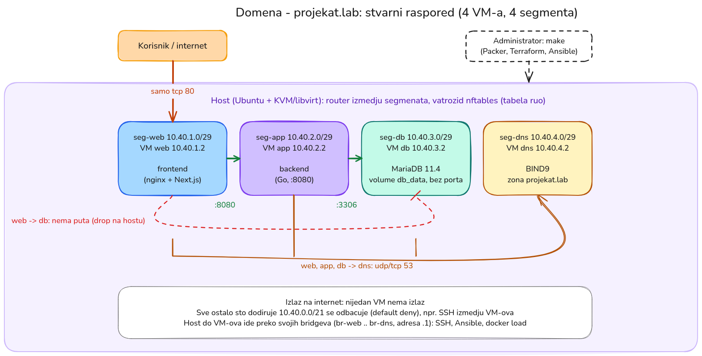

**Student:** Adi Kadušić\
**Repozitorij:** <https://github.com/kadusic1/ruo_project>\
**Uputstvo za pokretanje, testove i dokaze:** `README.md` u repozitoriju

# Aplikacija i arhitektura

**Aplikacija** je *invoice tracker*: evidencija faktura (broj, klijent, iznos, status, rok plaćanja).
Ima tri sloja, svaki u svom kontejneru: frontend (Next.js statički export koji servira nginx),
backend (Go REST API) i bazu (MariaDB). Tok zahtjeva je samo frontend → backend → baza. nginx
prosljeđuje `/api/*` na `app.projekat.lab:8080`, a backend se spaja na `db.projekat.lab:3306`.

Aplikacija je izabrana **namjerno zbog osjetljivih podataka**. Fakture govore ko je kome i koliko
dužan, a to su finansijski i poslovni podaci klijenata. Zbog toga je cilj infrastrukture da napadač
koji preuzme izloženi frontend **nema put do baze**, i da ta zaštita ne zavisi od mašine koju je
preuzeo. Iz tog cilja dolaze odluke DO-2, DO-5 i DO-9.

**Arhitektura.** Četiri VM-a (web, app, db, dns). Svaki je sam u svojoj libvirt mreži u `route`
modu (`10.40.N.0/29`). Host je gateway svih mreža i usmjerava promet između njih, a nftables na
hostu propušta samo: internet → web (80), web → app (8080), app → db (3306) i svi → dns (53).
Sve ostalo se odbacuje, a nijedan VM nema izlaz na internet. Bazna slika VM-ova
nastaje Packerom, VM-ove i DNS zapise pravi Terraform, a konfiguraciju i isporuku radi Ansible.

# Pregled dizajnerskih odluka

| ID   | Pitanje                          | Izabrana opcija |
| -------- | ------------------ | ------------------------------------------------------------- |
| DO-1 | Koja aplikacija i koje tehnologije za svaki sloj? | vlastiti invoice tracker: Next.js (statički export) + nginx, Go, MariaDB 11.4 |
| DO-2 | Koliko VM-ova i kako su komponente raspoređene na njih? | opcija B: 4 VM-a (web, app, db, dns), svaki u svojoj libvirt mreži u `route` modu; host usmjerava i filtrira (nftables); DNS na zasebnom VM-u |
| DO-3 | Kakav je plan adresiranja? | `10.40.N.0/29` po segmentu (1 web, 2 app, 3 db, 4 dns), host `.1`, VM `.2`, statičke adrese iz cloud-init-a, bez DHCP-a |
| DO-4 | Odakle dolazi bazna slika VM-a? | vlastita Packer slika (pinovana Ubuntu 24.04 cloud slika + docker + bind9) + cloud-init za podešavanje po VM-u |
| DO-5 | Kako se grade i distribuiraju slike kontejnera? | multi-stage Dockerfile, build na hostu, prenos `docker save`/`load` preko Ansiblea, samo kad se ID slike razlikuje |
| DO-6 | Kako Ansible dobija adrese VM-ova koje je kreirao Terraform? | inventar i varijable generiše Terraform (`local_file`) iz jedne varijable `segments` |
| DO-7 | Kako su organizovane Ansible role i varijable? | role po funkciji (`firewall`, `dns`, `host_dns`, `app`); jedna rola `app` za sva tri sloja, sloj se bira kroz `group_vars/<grupa>` |
| DO-8 | Kako je projektovana DNS zona? | `projekat.lab`, TTL 300, jedan primarni BIND, bez PTR, sekundarnog servera i round-robina; zapisi servisa iz Terraforma, TSIG samo za ovu zonu |
| DO-9 | Kako se upravlja tajnama? | generisanje pri prvom pokretanju (Ansible `password` lookup) u `ansible/.secrets/` van Gita; `.env` po sloju (0600) |

# DO-1: Vlastiti invoice tracker: Next.js + nginx, Go, MariaDB

Status: prihvaćeno

## Kontekst

**Ograničavaju:** **AO-1** (troslojna aplikacija, svaki sloj u svom kontejneru, tok frontend → backend → baza); **AO-7** (vlastita autoritativna BIND zona, komponente se adresiraju samo DNS imenima); **AO-10** (podaci baze preživljavaju ponovno kreiranje kontejnera).

Treba troslojna aplikacija čiji je svaki sloj zaseban kontejner, a tok zahtjeva je strogo
frontend → backend → baza. Aplikacija se ne ocjenjuje, ali mora biti dovoljno mala da se objasni
red po red. Mora i primati konfiguraciju (adrese, lozinke) izvana, kroz varijable okruženja, jer
je infrastruktura pravi predmet projekta. Komponente se smiju adresirati samo DNS imenima.

## Razmotrene opcije

1. Gotova open-source aplikacija (npr. neki CMS ili wiki).
2. Vlastita mala aplikacija: Go backend, Next.js frontend, MariaDB.
3. Isto kao 2, ali s PostgreSQL ili MongoDB bazom.

## Odluka

Opcija 2, vlastiti **invoice tracker**:

- **frontend**: Next.js 16 sa `output: "export"`. Rezultat su statički fajlovi koje servira
  `nginx:1.27-alpine`, a nginx prosljeđuje `/api/` na `BACKEND_URL` (`http://app.projekat.lab:8080`);
- **backend**: Go 1.24 (standardni `net/http`, `go-sql-driver/mysql`), endpointi `GET/POST /invoices`
  i `GET /health`. Konfiguracija dolazi samo iz okruženja (`DSN`, `PORT`, `FRONTEND_ORIGIN`), a bez
  nje se program odmah prekida;
- **baza**: `mariadb:11.4`, šema i seed u `schema.sql` (idempotentni).

## Obrazloženje i posljedice

- **Fakture su osjetljivi podaci** (klijenti, iznosi), pa aplikacija daje stvaran razlog za
  strogu izolaciju slojeva i pažljivo rukovanje lozinkama baze (DO-2, DO-9).
- Statički export znači da u produkciji **nema Node.js procesa**. Izloženi sloj je samo nginx sa
  statičkim fajlovima, a to je najmanja moguća površina napada na jedinom sloju dostupnom izvana.
  Preglednik priča samo s web VM-om (isti origin), a backend nikad nije izložen internetu.
- Go daje jedan statički binarni fajl (`CGO_ENABLED=0`). Finalna slika je `alpine` s neprivilegovanim
  korisnikom `app`, mala je i brzo se prenosi na VM-ove (DO-5).
- MariaDB: relacioni model odgovara fakturama (`DECIMAL` iznos, `ENUM` status). Zvanična slika ima
  `healthcheck.sh` (Ansible čeka spremnost baze) i `docker-entrypoint-initdb.d` (šema pri prvom
  startu). PostgreSQL bi bio jednako dobar. MongoDB ne donosi ništa ovako strukturiranim podacima.
- Gotova aplikacija bi donijela mnogo koda i konfiguracije koju ne kontrolišem i koju je teško
  objasniti red po red. Vlastita aplikacija čita tačno one varijable koje infrastruktura postavlja.
- Gubi se: aplikacija je minimalna (nema autentikacije, izmjene ni brisanja faktura). To je
  prihvatljivo jer se ocjenjuje infrastruktura.

# DO-2: Četiri VM-a u zasebnim route mrežama, DNS na vlastitom VM-u

Status: prihvaćeno

## Kontekst

**Ograničavaju:** **AO-6** (svaki sloj u svom segmentu s vlastitom podmrežom, izvana samo frontend, frontend bez puta do baze, baza bez objavljenog porta); **AO-7** (vlastita autoritativna BIND zona, komponente se adresiraju samo DNS imenima); **AO-2** (sve je opisano kodom, podizanje i uklanjanje bez ručnih koraka).

Slojevi moraju biti mrežno izolovani: svaki u svom segmentu s vlastitom podmrežom, izvana dostupan
samo frontend, frontend bez mrežnog puta do baze, a baza bez objavljenog porta. Treba odlučiti
kako se segmenti izvode i gdje je DNS server. Podaci su osjetljivi (DO-1), pa je glavno pitanje
**ko provodi izolaciju i šta se dešava kad napadač preuzme frontend**.

## Razmotrene opcije

1. **A**: jedan VM, segmenti kao Docker mreže s fiksnim podmrežama, kontejner samo na mrežama koje mu trebaju.
2. **B**: po jedan VM za svaki segment, libvirt mreže u `route` modu, host usmjerava i filtrira; DNS na
   jednom od postojećih VM-ova.
3. **B**, a DNS na zasebnom, četvrtom VM-u u svom segmentu.

## Odluka

Opcija 3: **četiri VM-a** (web, app, db, dns). Svaki je sam u svojoj libvirt mreži `seg-<ime>`
(`route` mode, bridge `br-<ime>`). Host usmjerava između mreža i filtrira promet tabelom
nftables `ip ruo`. Politika je zapisana kao podaci u `ansible/group_vars/rtr/vars.yml`.

## Obrazloženje i posljedice

- Kod opcije A sve kontejnere izoluje **isti kernel i isti Docker daemon na istom VM-u**. Bijeg iz
  kontejnera frontenda ili root na tom VM-u znače pristup svim mrežama, bazi i njenom volumenu.
  Kod opcije B svaki sloj ima svoj kernel. Pošto je svaki VM sam u svojoj L2 mreži, **jedini put do
  drugog sloja vodi kroz host**, a pravila su na hostu, van dohvata VM-ova. Ni root na
  kompromitovanom web VM-u ne može otvoriti put do baze.
- Isti mehanizam daje kontrolu izlaza: **nijedan VM nema izlaz na internet**, pa podaci iz baze ne
  mogu lako napustiti sistem, a napadač ne može preuzeti alate, čak ni s preuzetog frontenda.
  Lanac `input` zatvara i put preko samog hosta: libvirt na `.1` svakog segmenta pokreće dnsmasq
  koji bi prosljeđivao vanjska imena, pa VM ne smije otvoriti novu vezu prema hostu.
- **DNS na zasebnom VM-u.** Na web VM-u (izloženom) bi preuzimanje frontenda značilo i kontrolu
  nad imenima. Napadač bi mogao preusmjeriti `db.projekat.lab`. Na app ili db VM-u bi taj VM morao
  primati DNS promet iz drugih segmenata, a to znači dodatni otvoren port na osjetljivom sloju.
  Zasebni VM ne otvara ništa novo ni na jednom sloju aplikacije.
- Ulaz izvana dozvoljava pravilo `iifname <uplink> → web 80`. Uplink se otkriva iz zadane rute
  hosta, a promet koji ne dodiruje `10.40.0.0/21` vatrozid ne dira (libvirt, Docker i ostalo rade normalno).
- **Baza bez objavljenog porta.** Kontejner baze radi s `network_mode: host` i bez `ports:`, pa
  MariaDB sluša direktno na adresi db VM-a, a do porta 3306 smije doći samo app segment (pravilo na
  hostu). `ports: "3306:3306"` bi upravo bio objavljen port. Docker bridge mreža bez porta bi bazu
  sakrila i od app VM-a, jer backend nije na istom Docker daemonu. Mrežnu granicu baze zato
  određuje vatrozid hosta, a ne Docker.
- Gubi se: 4 VM-a troše više resursa (4 × 1 GiB RAM). Host postaje ruter, pa `make config` i
  `make destroy` traže sudo. Vatrozid je jedna tačka kontrole (nema dodatnog vatrozida unutar VM-ova).
  Kod je složeniji (prenos slika bez interneta, split DNS na hostu).

# DO-3: Statičke adrese, /29 po segmentu unutar 10.40.0.0/21

Status: prihvaćeno

## Kontekst

**Ograničavaju:** **AO-6** (svaki sloj u svom segmentu s vlastitom podmrežom, izvana samo frontend, frontend bez puta do baze, baza bez objavljenog porta); **AO-3** (VM-ove kreira Terraform, parametri su varijable, adrese su outputi).

Svaki segment treba vlastitu podmrežu. Adrese moraju biti poznate unaprijed: od njih zavise DNS
zapisi (Terraform), pravila vatrozida (Ansible) i inventar. Opseg se ne smije sudarati s mrežama
koje već postoje na hostu.

## Razmotrene opcije

1. Libvirt DHCP (dinamičke adrese ili rezervacije po MAC-u).
2. Statičke adrese koje postavlja cloud-init (netplan), DHCP isključen.
3. Veličina podmreže segmenta: /24, /30 (tačno gateway + VM) ili /29.
4. Adresni prostor projekta: široki opseg (/16) ili najmanji agregat koji pokriva sve segmente.

## Odluka

Statičke adrese iz cloud-init-a, u adresnom prostoru **`10.40.0.0/21`**, sa **`10.40.N.0/29`** po segmentu:

| Segment | Podmreža     | Host (gateway) | VM        | MAC               |
| ------- | ------------ | -------------- | --------- | ----------------- |
| web     | 10.40.1.0/29 | 10.40.1.1      | 10.40.1.2 | 52:54:00:40:01:02 |
| app     | 10.40.2.0/29 | 10.40.2.1      | 10.40.2.2 | 52:54:00:40:02:02 |
| db      | 10.40.3.0/29 | 10.40.3.1      | 10.40.3.2 | 52:54:00:40:03:02 |
| dns     | 10.40.4.0/29 | 10.40.4.1      | 10.40.4.2 | 52:54:00:40:04:02 |

Sve je zapisano u jednoj Terraform varijabli `segments`. Netplan bira sučelje po MAC adresi i
postavlja adresu, zadanu rutu preko `.1` i resolver (dns VM, i za sam dns VM).

## Obrazloženje i posljedice

- Statičke adrese znaju se **prije podizanja VM-a**, pa Terraform odmah ima outpute, pravi inventar
  i ne čeka DHCP lease (`wait_for_lease = false`). Plan poslije `apply` je stabilan (0 promjena).
  DHCP bi dodao servis koji može kasniti ili dodijeliti drugu adresu, a rezervacije bi bile isti
  statički podaci samo na drugom mjestu.
- `10.40.0.0/21` se ne sudara s libvirt `default` mrežom (192.168.122.0/24), Dockerom
  (172.17.0.0/16) ni tipičnim kućnim mrežama. To je najmanji agregat koji pokriva sve segmente
  (10.40.0.0–10.40.7.255), pa vatrozid i BIND (`allow-query`) obuhvataju samo
  onoliko adresnog prostora koliko projekat koristi, a jedno pravilo "ne diraj promet koji ne
  dodiruje projekat" je dovoljno. Ima mjesta za segmente do broja 7, a za više se agregat proširuje
  u jednoj varijabli (`fw_mreza`).
- Šema je čitljiva: treći oktet = segment, `.1` = host, `.2` = VM, MAC nosi isti broj. Greška
  se vidi na prvi pogled.
- **/29** daje 6 upotrebljivih adresa: host `.1`, VM `.2` i slobodne `.3`–`.6`. To je dovoljno za
  jedan VM, uz mjesto za drugu instancu sloja ili pomoćni servis bez promjene plana. Podmreža je
  veličine onoga što u njoj stvarno živi, pa dodatni ili pogrešno podešen uređaj nema iz čega
  uzeti adresu.
- /30 bi tačno stao (gateway + VM), ali bez ijedne slobodne adrese, pa bi svaki rast sloja tražio
  novo adresiranje i ponovno kreiranje VM-ova. /31 (RFC 3021) libvirt i dnsmasq ne podržavaju
  pouzdano. /24 bi po segmentu ostavio više od 250 adresa bez namjene.
- Izolaciju provode zasebni bridge-ovi i nftables na hostu. Mala maska je dodatni sloj, a ne
  zamjena za vatrozid.
- Prefiks se piše samo u varijabli `segments`. Cloud-init adresu Terraform izvodi iz nje
  (`split("/", subnet)[1]`), pa mreža i VM ne mogu imati različite maske.
- Gubi se: promjena adrese traži ponovno kreiranje VM-a (cloud-init se primjenjuje pri prvom
  podizanju), a dodavanje segmenta znači novi unos u `segments` i nova pravila vatrozida.

# DO-4: Vlastita Packer slika uz cloud-init

Status: prihvaćeno

## Kontekst

**Ograničavaju:** **AO-4** (početnu konfiguraciju radi cloud-init, SSH ključ, prijava lozinkom isključena); **AO-2** (sve je opisano kodom, podizanje i uklanjanje bez ručnih koraka); **AO-6** (svaki sloj u svom segmentu s vlastitom podmrežom, izvana samo frontend, frontend bez puta do baze, baza bez objavljenog porta).

VM-ovi trebaju Docker (svi slojevi) i BIND (dns VM). Zbog DO-2, app i db nemaju izlaz na internet,
a dns smije samo na port 53. Paketi se zato ne mogu instalirati pri konfiguraciji. Početnu
konfiguraciju svakog VM-a (korisnik, SSH ključ, mreža) mora raditi cloud-init. Okruženje se mora
moći podići od nule, uvijek na isti način.

## Razmotrene opcije

1. Javna Ubuntu cloud slika + instalacija paketa (cloud-init ili Ansible rola `docker`), uz
   privremeno otvoren izlaz na internet za sve VM-ove.
2. Vlastita slika izgrađena Packerom, s paketima unaprijed instaliranim, + cloud-init za podešavanje po VM-u.

## Odluka

Opcija 2. `packer/ubuntu.pkr.hcl` kreće od **datirane** Ubuntu 24.04 cloud slike
(`noble/20261017`, provjeren sha256). Instalira `docker.io`, `docker-compose-v2` i `bind9`,
isključi `named` (uključuje ga samo rola `dns`), zaključa privremenu build lozinku i očisti
cloud-init. Terraform tu sliku učita kao bazni volumen, a svaki VM dobija copy-on-write disk nad njom.
Cloud-init (`terraform/vm/cloud-init/`) zatim postavlja hostname, korisnika `student` (sudo, grupa
`docker`, samo SSH ključ, `lock_passwd`), `ssh_pwauth: false` i statičku mrežu.

## Obrazloženje i posljedice

- Opcija 1 znači da app i db, makar privremeno, imaju put prema internetu, a to ruši pravilo
  izolacije iz DO-2. Ako bi run pukao prije ponovnog zatvaranja, izlaz bi ostao otvoren.
  S Packer slikom **vatrozid se primijeni jednom i ostaje zatvoren**.
- Datirana slika s checksumom daje istu osnovu pri svakom buildu. `current` bi se mijenjala ispod projekta.
- Konfiguracija je brža i jednostavnija: Ansible ništa ne instalira na VM-ovima, samo konfiguriše.
- Jedna slika za sve VM-ove (i `bind9` na svima, ugašen) jednostavnija je od dvije slike. Neiskorišten
  paket ne radi i ne sluša ni na jednom portu.
- `make image` je pravilo nad fajlom: slika se gradi samo ako ne postoji ili je kod u `packer/` noviji
  (oko 7 minuta). `make destroy` je ne briše, kao keš. Potpuno od nule: `make destroy clean-image all`.
- Gubi se: sigurnosne zakrpe stižu tek novim buildom (nova datirana slika u kodu). `make` gleda mtime,
  pa git operacije koje diraju `packer/` mogu izazvati ponovni build bez stvarne promjene.

# DO-5: Multi-stage build na hostu i prenos sa docker save/load

Status: prihvaćeno

## Kontekst

**Ograničavaju:** **AO-1** (troslojna aplikacija, svaki sloj u svom kontejneru, tok frontend → backend → baza); **AO-5** (konfiguracija Ansible rolama, playbook je idempotentan); **AO-6** (svaki sloj u svom segmentu s vlastitom podmrežom, izvana samo frontend, frontend bez puta do baze, baza bez objavljenog porta).

Slike backenda i frontenda treba izgraditi, a sve tri slike (i `mariadb`) dostaviti VM-ovima. App i
db nemaju internet (DO-2), pa ne mogu ni graditi (preuzimanje Go modula i npm paketa) ni povlačiti
slike. Isporuka mora biti idempotentna: drugi `make deploy` bez promjena.

## Razmotrene opcije

1. Build na ciljnom VM-u (`docker compose build` na svakom VM-u).
2. Build lokalno + registry (vlastiti registry u nekom segmentu ili javni).
3. Build na hostu + prenos arhive slike (`docker save` → kopija → `docker load`) preko Ansiblea.

## Odluka

Opcija 3 s **multi-stage Dockerfile-ovima**. Host gradi `ruo/backend:1.0` i `ruo/frontend:1.0`
(`docker compose --profile app --profile web build`) i povlači `mariadb:11.4`. Rola `app` uporedi
ID slike na hostu i na VM-u. Samo ako se razlikuju, uradi `docker save` na hostu, kopira tar i
`docker load` na VM-u. Compose na VM-u radi s `build: never` i `pull: never`.

## Obrazloženje i posljedice

- Opcija 1 traži internet i alate za build na svakom VM-u. To se kosi s DO-2, a na produkcijske
  mašine unosi kompajler i izvorni kod.
- Opcija 2 dodaje novi servis koji treba podići, osigurati (TLS, autentikacija) i otvoriti u
  vatrozidu prema app i db segmentu. To je novi put u inače zatvorene segmente.
- Kod opcije 3 jedina veza VM-ova sa slikama je SSH s hosta, a on već postoji za Ansible. Nijedan
  segment ne dobija novi port.
- Multi-stage build: u finalnoj slici nema kompajlera, `node_modules` ni izvornog koda. Backend je
  `alpine` + binarni fajl, frontend `nginx:alpine` + statika. Slike su male, pa je prenos brz.
- Idempotentnost: `BUILDX_NO_DEFAULT_ATTESTATIONS=1` isključuje provenance atestaciju (ona sadrži
  vrijeme builda), pa isti kod daje isti ID i slika se drugi put ne šalje (`changed=0`).
- Gubi se: nema historije verzija (tag je stalno `1.0`, a razliku nosi ID). Svaka promjena koda
  znači prenos cijele arhive te slike. Host mora imati Docker.

# DO-6: Inventar i varijable generiše Terraform

Status: prihvaćeno

## Kontekst

**Ograničavaju:** **AO-3** (VM-ove kreira Terraform, parametri su varijable, adrese su outputi); **AO-5** (konfiguracija Ansible rolama, playbook je idempotentan).

VM-ove i adrese pravi Terraform, a Ansible ih mora znati. Ansible treba i podmreže (za vatrozid),
zonu, TTL i adresu DNS servera. Isti podatak ne smije biti upisan na dva mjesta, jer se tada može razići.

## Razmotrene opcije

1. Ručno pisan `inventory.ini`.
2. Inventar generisan iz Terraform konfiguracije.
3. Dinamički inventar (plugin koji pita libvirt ili čita Terraform state).

## Odluka

Opcija 2. Terraform (`resource "local_file"`) pri svakom `apply` piše:

- `ansible/inventory.ini`: grupe `web`, `app`, `db`, `dns` s adresama i grupu `rtr` (sam host,
  `ansible_connection=local`, za vatrozid i split DNS), plus korisnika i SSH ključ;
- `ansible/group_vars/all/terraform.yml`: `tf_subnets`, `tf_ips`, `dns_zone`, `dns_ip`, `dns_ttl`.

Oba fajla nastaju iz iste varijable `segments` i nisu u Gitu. `terraform/dns` čita adrese iz
state-a `terraform/vm` (`terraform_remote_state`), a testovi čitaju isti inventar.

## Obrazloženje i posljedice

- **Jedan izvor istine.** Adresa se mijenja samo u `segments`, a mreža, cloud-init, inventar, pravila
  vatrozida, DNS zapisi i testovi to automatski prate.
- Ručni inventar bi duplirao adrese i ne bi pratio promjene. Dinamički inventar bi dodao plugin i
  zavisnost od libvirt API-ja ili formata state-a, iako su adrese statičke i poznate unaprijed (DO-3).
- Generisani fajl je običan tekst, pa se lako pregleda i ne zavisi od pristupa Terraformu u toku Ansible runa.
- Bez generisanih varijabli `site.yml` odmah staje s porukom "pokreni `make infra`", umjesto da padne
  negdje na pola.
- Gubi se: Ansible vidi stanje iz posljednjeg `apply`. Ako se fajlovi obrišu, treba ponovo `make infra`.

# DO-7: Role po funkciji, sloj se bira kroz group_vars

Status: prihvaćeno

## Kontekst

**Ograničavaju:** **AO-5** (konfiguracija Ansible rolama, playbook je idempotentan).

Konfiguracija mora biti u rolama i idempotentna. Ciljevi su različiti: host (vatrozid, DNS hosta),
dns VM (BIND) i tri VM-a aplikacije koji rade isto (slika, compose, `.env`), samo za drugi sloj.
Konfiguracija servera (`make config`, traži sudo) i isporuka aplikacije (`make deploy`, bez sudo)
su različiti koraci.

## Razmotrene opcije

1. Rola po komponenti (`frontend`, `backend`, `database`, …).
2. Rola po funkciji, s varijablama koje biraju šta se primjenjuje na kojoj grupi.

## Odluka

Opcija 2. Četiri role i dva playbooka:

| Rola       | Gdje     | Šta radi |
| ---------- | ------------ | ---------------------------------------------------------------- |
| `firewall` | host     | nftables pravila iz šablona (`nft -c` provjera), `ip_forward`, systemd unit za boot |
| `dns`      | dns VM   | TSIG ključ, `named.conf.*` (`named-checkconf`), početna zona, uključuje `named` |
| `host_dns` | host     | systemd unit `ruo-dns` (split DNS za `projekat.lab` na `br-dns`) |
| `app`      | web, app, db | prenos slike, `compose.yaml`, `.env` po sloju, pokretanje profila, čekanje health-a |

`site.yml` = `firewall` → `dns` → `host_dns`; `deploy.yml` = build na hostu → `app` na db → app → web.

Varijable:

- `roles/*/defaults`: stvari koje pripadaju roli i rijetko se mijenjaju (`app_dir`, ime baze, DNS
  imena servisa `db.{{ dns_zone }}`, ime TSIG ključa, putanja zone);
- `group_vars/all/vars.yml`: zajedničko (`fw_mreza`, imena slika po sloju);
- `group_vars/rtr/vars.yml`: **politika vatrozida kao podaci** (`fw_javno`, `fw_pravila`);
- `group_vars/{web,app,db}/vars.yml`: samo `app_profile`, odnosno koji compose profil grupa pokreće;
- `group_vars/all/terraform.yml`: generiše Terraform (DO-6).

## Obrazloženje i posljedice

- Tri sloja se isporučuju istim koracima. Rola po komponenti bi te korake ponovila tri puta. Ovako
  je razlika jedna varijabla: **compose profil = ime grupe**.
- Politika vatrozida je pregledna tabela i mijenja se bez diranja nftables sintakse. Šablon je ne
  može prekršiti jer se generiše iz nje.
- Odvojeni playbookovi: `make deploy` ne traži sudo na hostu, a promjena aplikacije ne dira vatrozid ni DNS.
- Redoslijed isporuke db → app → web je bitan: backend pri startu provjerava bazu, a nginx pri startu
  razrješava `app.projekat.lab`. Rola na webu na kraju provjerava cijeli lanac (`/api/invoices`).
- Nema role `docker`, jer je Docker u slici (DO-4).
- Gubi se: rola `app` ima uslove po sloju (`when: app_profile == 'db'`), pa je manje "čista" od tri
  odvojene role.

# DO-8: Privatna zona projekat.lab, TTL 300, jedan primarni BIND

Status: prihvaćeno

## Kontekst

**Ograničavaju:** **AO-7** (vlastita autoritativna BIND zona, komponente se adresiraju samo DNS imenima); **AO-8** (DNS zapisi su Terraform resursi (RFC 2136), TSIG ključ mijenja samo zonu projekta).

Projekat treba vlastitu autoritativnu zonu (BIND), a komponente se adresiraju samo imenima. Zapisi
servisa su Terraform resursi (provider `hashicorp/dns`, RFC 2136), a TSIG ključ smije mijenjati samo
zonu projekta. Na odbrani se traži novi zapis ili drift, pa promjene moraju stizati brzo.

## Razmotrene opcije

1. Ime zone: stvarna domena, `.local`, ili privatna zona tipa `projekat.lab`.
2. TTL: kratak (60 s), srednji (300 s) ili dug (3600 s i više).
3. Dodaci: PTR zapisi (reverzna zona), sekundarni server, round-robin za više instanci.

## Odluka

- Zona **`projekat.lab`**, jedan primarni BIND na dns VM-u, `ns1.projekat.lab` = 10.40.4.2.
- **TTL 300 s**, s jednim izvorom: `dns_ttl` u `terraform/vm` (koriste ga rola `dns` za zonu i
  `terraform/dns` za zapise).
- Ansible pravi samo početnu zonu (SOA, NS, `ns1`) i to samo ako fajl ne postoji. Zapise servisa
  `web`, `app`, `db` i `dns` pravi Terraform (`dns_a_record_set`, adrese iz state-a `terraform/vm`).
- TSIG `ruo-tf` (hmac-sha256) sa `update-policy { grant ruo-tf zonesub ANY; }`, samo za ovu zonu.
- Samo autoritativni server (`recursion no`), upiti samo iz `10.40.0.0/21` i s localhosta, `allow-transfer none`.
- Bez PTR zapisa, sekundarnog servera i round-robina. Host razrješava zonu preko split DNS-a (`resolvectl`).

## Obrazloženje i posljedice

- Stvarna domena traži vlasništvo. `.local` je rezervisan za mDNS i sudara se s Avahi/resolved.
  `projekat.lab` je kratko, jasno privatno i ne koliduje ni sa čim na hostu.
- 300 s je kompromis: promjena zapisa se vidi za najviše 5 minuta, a keš i dalje smanjuje broj
  upita. 60 s bi samo povećao promet, a 3600 s bi sporo prikazivao izmjene na odbrani.
- Dinamička zona (`/var/lib/bind`) pripada BIND-u: on vodi journal i podiže serial. Zato je Ansible
  piše samo prvi put (`force: false`), inače bi svaki `make config` brisao Terraformove zapise.
  Svako ima jasan dio: Ansible server i zonu, Terraform zapise.
- `zonesub` ograničava ključ na imena unutar `projekat.lab`. Čak i ako tajna procuri, ne može
  dirati nijednu drugu zonu.
- Bez rekurzije server ne može biti otvoreni resolver. VM-ovi traže samo imena iz zone, a izlaza
  na internet ionako nemaju (DO-2), pa prosljeđivanje vanjskih imena ne bi imalo svrhu.
- PTR se ne koristi ni u jednom toku aplikacije. Sekundarni server bi tražio još jedan VM i
  transfer zone kroz vatrozid. Round-robin nema smisla s jednom instancom po sloju. Sve se može
  dodati bez promjene postojećeg dizajna.
- Gubi se: jedan DNS server je jedna tačka otkaza. Kad dns VM ne radi, novi nazivi se ne razrješavaju
  (postojeće veze rade dalje).

# DO-9: Tajne se generišu pri prvom pokretanju, van Gita

Status: prihvaćeno

## Kontekst

**Ograničavaju:** **AO-9** (tajne nikad nisu u Gitu u čistom obliku); **AO-2** (sve je opisano kodom, podizanje i uklanjanje bez ručnih koraka).

Tajne su lozinke baze, TSIG ključ i SSH ključevi. Nikad ne smiju biti u Gitu u čistom obliku, a
tajna koja je jednom ušla u historiju smatra se otkrivenom. Lozinke baze štite fakture, najosjetljiviji
dio sistema (DO-1). Okruženje se često briše i podiže od nule, a pokretanje mora ostati bez ručnih koraka.

## Razmotrene opcije

1. `ansible-vault`: šifrovan `vault.yml` u Gitu, lozinka za vault van Gita.
2. Generisanje pri prvom pokretanju, tajne samo na kontrolnoj mašini.
3. Ručno napravljen `.env` van Gita.

## Odluka

Opcija 2. Ansible `lookup('ansible.builtin.password', …)` pri prvom pokretanju generiše, a poslije
čita, tri fajla u `ansible/.secrets/` (u `.gitignore`): `tsig_ruo-tf` (44 znaka), `db_password` i
`db_root_password` (po 32 znaka).

- TSIG: BIND ga dobija kao `/etc/bind/ruo-tf.key` (0640, root:bind), a Terraform preko
  `TF_VAR_tsig_secret` iz Makefilea (varijabla je `sensitive`).
- Lozinke baze: rola `app` pravi `/opt/ruo-app/.env` (root, 0600) **samo s varijablama tog sloja**.
  db dobija `MARIADB_*`, app `DSN` i `FRONTEND_ORIGIN`, a web nijednu lozinku (samo `BACKEND_URL`).
- Taskovi s tajnama imaju `no_log: true`. SSH: u VM ide samo javni ključ, privatni ostaje na hostu.

## Obrazloženje i posljedice

- Lozinka koja nikad nije zapisana u repozitoriju ne može procuriti kroz njega. Ni šifrovana
  verzija ne ide u Git.
- Opcija 1 bi i dalje tražila lozinku za vault van Gita (ručni korak ili još jedan fajl). Uz to,
  šifrovane lozinke ostaju u historiji zauvijek, a mijenjaju se samo novim commitom. Za okruženje
  koje se redovno pravi od nule generisanje je jednostavnije, a svaki `make destroy` + `make all`
  daje nove lozinke.
- Opcija 3 je ručni korak i lako se zaboravi.
- Isti `lookup` drugi put čita postojeći fajl, pa je playbook idempotentan.
- Princip najmanjih privilegija: frontend, jedini izloženi sloj, ne zna nijednu lozinku. Root
  lozinku baze zna samo db VM.
- Raniji commitovi su imali podrazumijevane lozinke u `compose.yaml`. One su prepisivanjem historije
  uklonjene iz repozitorija i nisu u upotrebi, jer se sve lozinke sada generišu.
- **Svjesni izuzetak:** lozinka `packer` za korisnika `ubuntu` je u Gitu u čistom obliku
  (`packer/seed/user-data`, `ssh_password` u `packer/ubuntu.pkr.hcl`). Služi samo Packeru za SSH
  na privremeni build VM na hostu. Prije snimanja slike se zaključava (`passwd -l ubuntu`), a VM-ovi
  ionako ne primaju prijavu lozinkom (`ssh_pwauth: false`, provjerava `tests/ssh.sh`), pa ne
  otvara pristup nijednom VM-u projekta.
- Gubi se: tajne postoje samo na jednom hostu (nema dijeljenja ni rezervne kopije). Ako se
  `ansible/.secrets/` obriše dok VM-ovi postoje, nova lozinka se ne poklapa s već inicijalizovanom
  bazom. Rješenje je `make destroy` (briše i tajne i VM-ove), pa `make all`.
